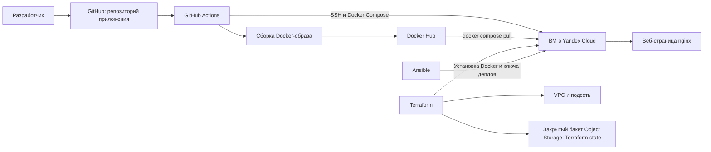

# Базовая DevOps-инфраструктура в Yandex Cloud. Выполнил Исмаилов Осман

## Аннотация

В работе создана базовая DevOps-инфраструктура для развёртывания тестового веб-приложения в Yandex Cloud. Инфраструктура описана с помощью Terraform, настройка виртуальной машины автоматизирована посредством Ansible. Приложение упаковано в Docker-образ и опубликовано в Docker Hub. GitHub Actions собирает образ при push в основную ветку, публикует его в реестре и развёртывает новую версию приложения на виртуальной машине.

В рамках работы созданы три GitHub-репозитория: с Terraform-конфигурацией, Ansible-playbook и приложением с настройками CI/CD. Работоспособность решения проверена подключением к виртуальной машине, запуском тестового Docker-контейнера и открытием веб-страницы по публичному IP-адресу.

## Содержание

1. Введение  
2. Архитектура решения  
3. Развёртывание инфраструктуры  
4. Настройка виртуальной машины  
5. Подготовка и публикация приложения  
6. Настройка CI/CD  
7. Проверка и воспроизводимость  
8. Заключение  
9. Список использованных источников  

## 1. Введение

### 1.1 Актуальность работы

Для публикации веб-приложения необходимо подготовить сервер, установить программное обеспечение, собрать приложение и обеспечить его обновление. Ручное выполнение этих операций занимает время и может привести к ошибкам. Кроме того, ручная настройка затрудняет повторное создание среды.

Инструменты инфраструктуры как код позволяют описать облачные ресурсы в конфигурационных файлах и управлять ими повторяемым способом. Контейнеризация помогает запускать приложение в подготовленном окружении, а средства CI/CD автоматизируют сборку, публикацию и развёртывание новой версии.

### 1.2 Цель и задачи

**Цель работы** — создать воспроизводимую DevOps-инфраструктуру в Yandex Cloud для автоматической сборки, публикации и развёртывания тестового веб-приложения.

Для достижения цели были поставлены следующие задачи:

1. Создать в Yandex Cloud сеть, подсеть и виртуальную машину.
2. Настроить удалённое хранение состояния Terraform в Object Storage.
3. Автоматизировать установку Docker на виртуальную машину с помощью Ansible.
4. Подготовить статическое веб-приложение, Dockerfile и файл Docker Compose.
5. Опубликовать Docker-образ в Docker Hub.
6. Настроить GitHub Actions для сборки образа и деплоя приложения.
7. Проверить доступность приложения и описать порядок повторного развёртывания.

**Объект работы** — процесс развёртывания тестового веб-приложения в облачной инфраструктуре.

**Предмет работы** — применение Terraform, Ansible, Docker и CI/CD для автоматизации этого процесса.

## 2. Архитектура решения

Разработчик отправляет изменения приложения в GitHub. GitHub Actions запускает workflow, который собирает Docker-образ и публикует его в Docker Hub. Затем workflow подключается к виртуальной машине по SSH, передаёт файл `compose.yaml` и обновляет контейнер с помощью Docker Compose.

Terraform создаёт сеть VPC, подсеть и виртуальную машину. Состояние Terraform сохраняется в закрытом бакете Object Storage. Ansible устанавливает Docker и Docker Compose, включает службу Docker и добавляет публичный SSH-ключ, используемый GitHub Actions для деплоя.

В проекте используются следующие репозитории и ресурсы:

| Назначение | Ссылка |
|---|---|
| Terraform-конфигурация | https://github.com/Mangice/devops-diplom-terraform |
| Ansible-playbook | https://github.com/Mangice/devops-diplom-ansible |
| Приложение и CI/CD | https://github.com/Mangice/devops-diplom-app |
| Docker Hub | https://hub.docker.com/r/mangice/devops-diplom |
| Развёрнутое приложение | http://84.201.159.233 |

Публичный IP-адрес указан на момент проверки и может измениться после пересоздания виртуальной машины.

## 3. Развёртывание инфраструктуры

### 3.1 Подготовка доступа и Terraform

Terraform был установлен на управляющую Ubuntu-машину. Для доступа к Yandex Cloud создан сервисный аккаунт, которому назначены необходимые права. Авторизованный JSON-ключ хранится локально вне Git-репозитория.

Для удалённого хранения состояния создан закрытый бакет Object Storage `devops-diplom`. Для доступа Terraform к бакету используется отдельный статический ключ. Значения ключей передаются через переменные окружения и не сохраняются в исходном коде.

Terraform-конфигурация и файл блокировки провайдера находятся в репозитории Terraform. Каталог `.terraform`, файлы состояния и локальные файлы переменных исключены из Git.

### 3.2 Создание сети и виртуальной машины

Terraform-конфигурация создаёт виртуальную сеть VPC, подсеть с диапазоном `10.10.0.0/24` и виртуальную машину в зоне `ru-central1-a`.

Для виртуальной машины выбрана экономичная конфигурация:

| Параметр | Значение |
|---|---|
| Операционная система | Ubuntu 24.04 |
| Платформа | Intel Ice Lake, `standard-v3` |
| vCPU | 2, доля производительности 20% |
| Оперативная память | 2 ГБ |
| Загрузочный диск | HDD, 10 ГБ |
| Режим работы | Прерываемая виртуальная машина |
| Сетевой доступ | Публичный IP-адрес |

Перед созданием ресурсов конфигурация проверена командой `terraform validate`, а предполагаемые изменения — командой `terraform plan`. После проверки выполнена команда `terraform apply`. В результате созданы сеть, подсеть и виртуальная машина.

После развёртывания ВМ получила публичный IP-адрес `84.201.159.233`. SSH-подключение к серверу проверено под пользователем `ubuntu`.

### 3.3 Хранение состояния Terraform

Файл Terraform state хранится в бакете Object Storage. Удалённое хранение позволяет сохранять состояние отдельно от управляющей машины и использовать его при последующих запусках Terraform.

Бакет создан с закрытым доступом. Он не управляется основной Terraform-конфигурацией и поэтому не удаляется командой `terraform destroy`.

## 4. Настройка виртуальной машины

Настройка сервера автоматизирована Ansible-playbook. Он устанавливает пакеты Docker и Docker Compose, запускает службу Docker и добавляет пользователя `ubuntu` в группу `docker`. Playbook также добавляет публичный SSH-ключ для подключения GitHub Actions.

После выполнения playbook проверены подключение к серверу и права пользователя на управление Docker. Команда `docker version` показала версии клиента и Docker Engine `29.1.3`. Для проверки контейнеризации запущен контейнер `hello-world`, который вывел сообщение `Hello from Docker!`.

## 5. Подготовка и публикация приложения

В качестве тестового приложения создана статическая веб-страница на основе nginx. Страница содержит текст «DevOps диплом: тестовое приложение» и сообщение о том, что открытие страницы подтверждает успешный запуск контейнера.

В Dockerfile используется образ `nginx:alpine`; файл `index.html` копируется в каталог nginx. Файл `compose.yaml` описывает запуск контейнера и публикацию порта 80. Настройки образа и тега передаются через `.env`.

Для хранения образа создан публичный репозиторий Docker Hub `mangice/devops-diplom`. GitHub Actions публикует в него теги `latest` и с идентификатором коммита.

## 6. Настройка CI/CD

В репозитории приложения создан workflow GitHub Actions. Он запускается при push в ветку `main` и выполняет следующие действия:

1. Получает исходный код репозитория.
2. Настраивает Docker Buildx.
3. Выполняет вход в Docker Hub с использованием GitHub Actions secrets.
4. Собирает Docker-образ и отправляет его в Docker Hub.
5. Подключается по SSH к виртуальной машине.
6. Передаёт `compose.yaml` и `.env`.
7. Загружает новую версию образа и перезапускает приложение с помощью Docker Compose.

Для работы workflow в настройках репозитория добавлены секреты `DOCKERHUB_USERNAME`, `DOCKERHUB_TOKEN`, `VM_HOST`, `VM_USER`, `VM_SSH_PRIVATE_KEY` и `VM_KNOWN_HOSTS`. Значения токенов и приватных ключей не хранятся в Git и не включены в отчёт.

При пересоздании виртуальной машины её публичный IP и ключ SSH-сервера могут измениться. В этом случае необходимо обновить секреты `VM_HOST` и `VM_KNOWN_HOSTS`, а также IP-адрес в локальном Ansible inventory.

## 7. Проверка и воспроизводимость

Проведённые проверки подтвердили работоспособность компонентов проекта:

| Проверка | Результат |
|---|---|
| Создание VPC, подсети и ВМ средствами Terraform | Успешно |
| Удалённое хранение Terraform state в Object Storage | Настроено |
| Подключение к ВМ по SSH | Успешно |
| Установка Docker и Docker Compose с помощью Ansible | Успешно |
| Запуск тестового контейнера `hello-world` | Успешно |
| Публикация образа в Docker Hub | Успешно |
| Сборка и публикация образа через GitHub Actions | Успешно |
| Деплой приложения на виртуальную машину | Успешно |
| Открытие веб-страницы по публичному IP | Успешно |

На момент проверки тестовая страница была доступна по адресу `http://84.201.159.233`.

Для повторного развёртывания необходимо подготовить сервисный аккаунт Yandex Cloud и закрытый бакет Object Storage, настроить локальное хранение ключей доступа, выполнить `terraform init`, `terraform plan` и `terraform apply`, затем указать новый публичный IP в Ansible inventory и запустить playbook. После обновления секретов GitHub Actions push в ветку `main` запускает сборку, публикацию образа и деплой приложения.

Виртуальная машина работает в прерываемом режиме и может быть остановлена облачной платформой. Перед запуском pipeline необходимо проверять её статус. Для удаления ВМ, подсети и VPC используется `terraform destroy`; бакет с состоянием Terraform остаётся отдельно.

## 8. Заключение

В ходе работы создана базовая DevOps-инфраструктура для тестового веб-приложения в Yandex Cloud. Terraform используется для создания сети, подсети и виртуальной машины, а состояние инфраструктуры хранится в закрытом бакете Object Storage.

Ansible автоматизирует установку Docker и настройку SSH-доступа для деплоя. Приложение упаковано в Docker-образ и опубликовано в Docker Hub. GitHub Actions собирает образ при push в ветку `main`, отправляет его в реестр и развёртывает новую версию на виртуальной машине.

Работоспособность подтверждена успешным запуском тестового контейнера, успешным выполнением CI/CD workflow и доступностью веб-страницы по публичному IP-адресу. Поставленная цель достигнута.

Решение предназначено для учебной демонстрации. Для промышленной эксплуатации дополнительно потребовались бы доменное имя, HTTPS, более строгие сетевые правила и отказоустойчивая схема. Прерываемая ВМ может автоматически останавливаться, поэтому приложение не гарантирует постоянную доступность.

## 9. Список использованных источников

1. Документация Yandex Cloud по Terraform state в Object Storage: https://yandex.cloud/en/docs/terraform/tutorials/terraform-state-storage.
2. Документация Yandex Cloud по прерываемым виртуальным машинам: https://yandex.cloud/en/docs/compute/concepts/preemptible-vm.
3. Документация Yandex Cloud по уровням производительности vCPU: https://yandex.cloud/en/docs/compute/concepts/performance-levels.
4. Документация Docker по Personal Access Tokens: https://docs.docker.com/security/access-tokens/personal-access-tokens/.
5. Документация GitHub по секретам GitHub Actions: https://docs.github.com/en/actions/how-tos/write-workflows/choose-what-workflows-do/use-secrets.
6. Документация Ansible: https://docs.ansible.com/.
7. Документация Terraform: https://developer.hashicorp.com/terraform/docs.
